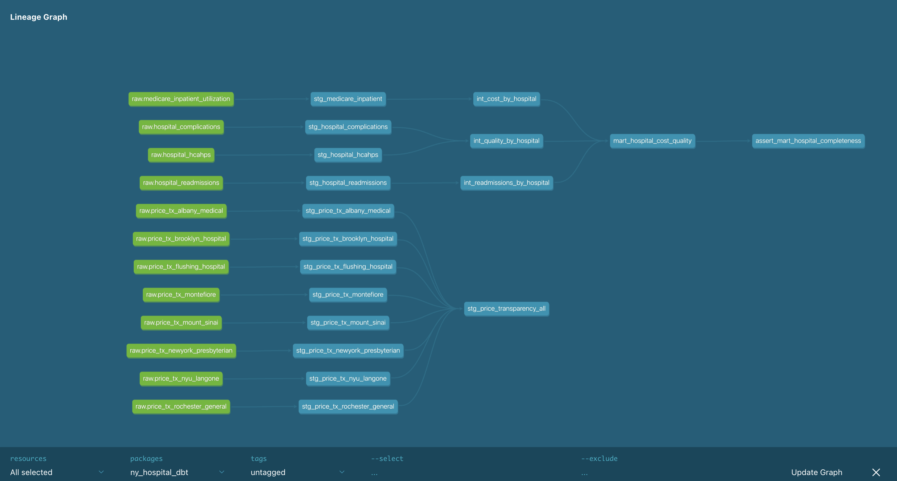

# NY Hospital Cost & Quality Variance

Does what a hospital charges, or how its patients rate it, tell you anything
about the quality of care it delivers? I answered that with three public
datasets, a tested dbt + BigQuery pipeline, and a weekly refresh that keeps the
numbers current.

## Key finding

Across 90 New York hospitals, patient-satisfaction ratings track 30-day
readmission performance (r between -0.40 and -0.52 across weekly refreshes,
p < 0.001 every time). Medicare payment per discharge does not (r = -0.06, not
significant). Patient experience carries a real quality signal; the price tag
does not.

*(This is a live pipeline, so the exact coefficient moves as CMS republishes:
r = -0.52 at the Sept 2026 refresh used in the memo, r = -0.40 at the Nov 16 2026
refresh. See the note at the end.)*

[Live dashboard (Tableau Public)](https://public.tableau.com/app/profile/meet.patel5823/viz/NYHospitalcostquality/Dashboard1)
 · [One-page findings memo](docs/findings_memo.md)
 · [Refreshable Excel report](excel/NY_Hospital_Cost_Quality.xlsx)

## Why I built it

Health plans want to steer patients to hospitals that deliver good outcomes
without overpaying, which means knowing which visible signal — price or patient
reviews — actually tracks clinical quality. I wanted to answer that with public
data, and to build it as a tested, automated pipeline rather than a one-off
notebook, so the answer stays reproducible and current.

I used messy, real-world public data on purpose instead of a clean Kaggle set, so
the project exercises the whole workflow: sourcing, data-quality diagnosis,
modeling, testing, analysis, visualization, and automation.

## Stack

- **Languages:** SQL, Python (pandas, scipy, requests)
- **Warehouse:** Google BigQuery
- **Modeling:** dbt (staging → intermediate → marts), dbt_utils, 13 data-quality tests
- **Analytics:** correlation and significance testing, volume-weighting, confound analysis
- **BI:** Tableau (interactive dashboard), Excel + Power Query (refreshable)
- **Automation:** GitHub Actions (weekly scheduled run)
- **AI in the loop:** LLM-based test-failure triage (classification only, human-reviewed)

## How it works

The quality and cost data land raw in BigQuery, untouched. dbt cleans them in
staging, aggregates to one row per hospital in intermediate models, and joins
them into a single mart. Tests run on every build. The weekly Action re-ingests
the CMS data, rebuilds, tests, and re-exports the report.



*Raw sources (green) → cleaned staging models → hospital-level intermediate
models → one analytical mart → tests. dbt builds this dependency graph
automatically from the code.*


A separate, optional module unifies eight hospital price-transparency files into
one schema. It's a data-engineering exercise and does not feed the finding, so
it's kept out of the default build — details under "Price transparency" below.

## Data sources (all free, public, no registration)

| Source | Provides | Role |
|---|---|---|
| CMS Provider Data Catalog (API) | readmissions, complications, HCAHPS patient surveys | quality |
| CMS Medicare Inpatient Utilization & Payment (CSV) | payment per hospital per procedure (DRG) | cost |
| Hospital price-transparency files (8 NY hospitals) | negotiated insurer rates | pricing (optional, ~11.9M rows) |

## Data quality as a deliverable

Most portfolio projects use pre-cleaned data. This one loads data raw and
documents 10 real data-quality problems with evidence in
[`docs/data_quality_findings.md`](docs/data_quality_findings.md), including:

- Three different hospital-ID schemes across sources (CCN vs NPI vs EIN) — the core join problem.
- 36% of readmission values and 87% of HCAHPS rows are structurally suppressed by CMS.
- Three incompatible price-file formats (tall CSV, a 3,700-column wide CSV, nested JSON) unified into one schema.
- Character-encoding bugs and a UTF-8 BOM that surfaced two steps from its cause.

## Testing, automation, and AI

- 13 dbt tests (`not_null`, `unique`, `accepted_range`, `accepted_values`, plus a custom integrity test) enforce the data-quality rules on every run.
- A defect was deliberately introduced and caught, to prove the tests actually work (in git history and the triage log).
- On a test failure, an LLM classifies the failure type and drafts a plain-English root-cause summary for human review ([`docs/llm_triage_log.md`](docs/llm_triage_log.md)). It is deliberately kept out of any metric computation.
- The weekly GitHub Actions pipeline re-ingests CMS data, rebuilds and tests everything, and re-exports the report, unattended.

## The analysis

- Cost is the volume-weighted average Medicare payment across a hospital's real case mix.
- Quality is the risk-adjusted 30-day excess readmission ratio (1.0 = as expected).
- Correlations use `scipy.stats.pearsonr`. Robustness is checked within each region, so the finding isn't a geography artifact — it holds in NYC, the suburbs, and upstate. Full write-up: [`docs/analysis_findings.md`](docs/analysis_findings.md).

**Honest caveat (stated, not buried):** raw cost differs about 89% between NYC and
upstate hospitals largely because of Medicare's geographic wage index, not
efficiency ($29,531 vs $15,600 median per discharge). The high-cost, worse-outcome
cluster is concentrated in NYC safety-net hospitals serving more complex patients.
This is not evidence that they are wasteful, and the README does not claim it is.

## Price transparency (optional module)

Eight NY hospitals publish machine-readable standard-charge files in three
incompatible shapes: a tall CSV, a 3,700-column wide CSV (unpivoted natively with
BigQuery UNPIVOT), and nested JSON. I unify all three into one schema, about 11.9M
rows. It's a multi-format ingestion exercise and is not part of the
cost-versus-quality finding, which runs on Medicare payments.

The project runs on BigQuery's free sandbox, which force-expires every table after
60 days. These large, one-time tables are therefore kept out of the weekly build,
so a scheduled refresh never depends on data that can expire. Build them on demand:

```bash
cd ny_hospital_dbt && dbt build --vars 'build_price: true'
```

## Repository map

```
ingest_cms_api.py, ingest_medicare_inpatient.py   CMS quality + Medicare cost → BigQuery (raw)
load_price_transparency.py                        optional: 8 hospital price files → BigQuery
generate_wide_unpivot_sql.py                      code-generates dbt SQL for the wide price file
ny_hospital_dbt/                                  dbt project (staging → intermediate → mart, 13 tests)
analysis_cost_quality.py, analysis_robustness.py  the statistical analysis
llm_triage.py                                     LLM test-failure triage (human-reviewed)
export_for_tableau.py                             mart → CSV for Tableau and Excel
audit_pipeline.py                                 end-to-end pipeline audit
.github/workflows/weekly_refresh.yml              weekly automation
docs/                                             memo, data-quality doc, analysis, lineage graph, triage log
tableau/, excel/                                  dashboard workbook + refreshable report
```

## Reproduce it

```bash
python -m venv venv && source venv/bin/activate
pip install requests pandas scipy google-cloud-bigquery dbt-core dbt-bigquery anthropic
# set GOOGLE_APPLICATION_CREDENTIALS + GCP_PROJECT_ID (BigQuery service account)
python ingest_cms_api.py && python ingest_medicare_inpatient.py
cd ny_hospital_dbt && dbt deps && dbt build     # core models + 13 tests
# optional price-unification module:
dbt build --vars 'build_price: true'
```

## Notes and limitations

- **Live pipeline:** figures update weekly as CMS republishes. The satisfaction coefficient has ranged from r = -0.40 to -0.52 across refreshes (-0.44 early on, -0.52 in Sept 2026, -0.40 on Nov 16 2026), always significant at p < 0.001. The finding is stable in direction even as the exact number moves.
- Public CMS data supports a defensible finding, not clinical causation.
- Scoped to 90 NY hospitals with sufficient Medicare volume.
- A portfolio project, not production experience.

---

*Built by Meet Patel. Questions welcome via GitHub issues.*
